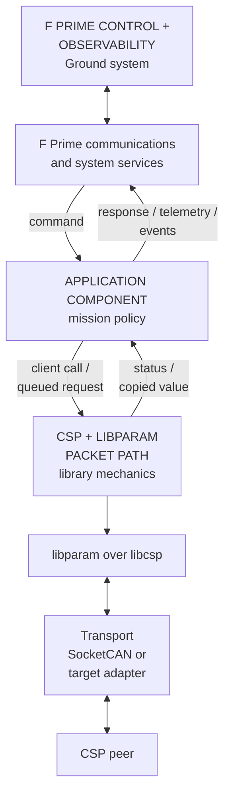
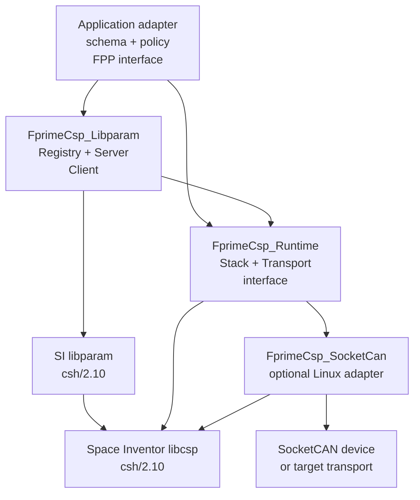
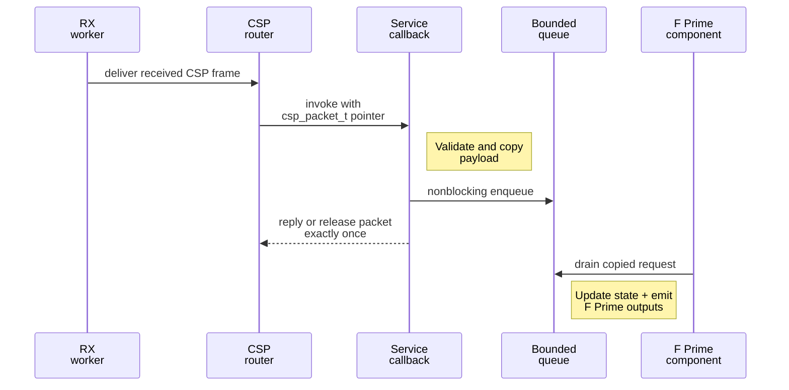
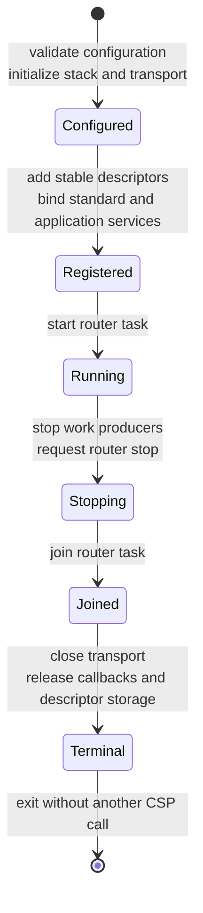

# Architecture and boundaries

This library lets an F Prime application use CSP and libparam without making
CSP the F Prime ground protocol. F Prime still owns application control and
observability. libcsp and libparam move spacecraft packets and parameter values
over the selected transport.

## CSP at a high level

CubeSat Space Protocol (CSP) is a small packet network for embedded systems.
Each device has a **CSP node** address. A packet identifies its source and
destination nodes, and a **destination port** selects the service that receives
it. libcsp supplies packet buffers, connections, routing, service callbacks,
and network interfaces.

An interface carries CSP packets over a concrete link. The supplied Linux
adapter uses SocketCAN, while another target can implement the same `Transport`
boundary for its CAN driver or another supported CSP medium. The router task
repeatedly calls `csp_route_work()` so received packets reach connections and
bound services.

## libparam at a high level

libparam adds typed parameter operations on top of CSP. A **parameter descriptor**
records a parameter ID, type, array shape, storage address, name, and owning
node. The application owns the descriptor and every object it references.

A server registers descriptors and services read and write requests for them
on **CSP port 10**. A client supplies a matching descriptor and pulls or pushes
a value. libparam serializes the request and response; libcsp transports them.
Registration does not create an F Prime parameter or telemetry channel, and it
does not decide whether a write is safe or authorized.

## How F Prime normally handles commands and telemetry

F Prime applications are assembled from components and ports. [FPP][] declares
a component's commands, telemetry channels, events, and topology connections.
In the standard `ComFprime.Subtopology`, `Svc::FprimeDeframer` extracts an F
Prime packet from the received frame. `Svc::FprimeRouter` routes that packet by
type through its output port, and the topology connects command packets to
`Svc::CommandDispatcher`. The command dispatcher identifies the destination
component and invokes its generated command input; it does not implement the
application command. When the input is asynchronous, the generated
active-component base queues the work for the component's own thread. The
generated handler then reports one command response with `cmdResponse_out()`.

In the other direction, generated `tlmWrite_<CHANNEL>()` and
`log_<SEVERITY>_<EVENT>()` functions send telemetry and events through F Prime
ports. A deployment typically collects them with `Svc::TlmChan` (or
`Svc::TlmPacketizer`) and `Svc::EventManager`, then frames them for the ground
link. This path remains independent of CSP and CAN.

The table maps the architectural names used in this guide to the relevant F
Prime C++ classes. The source links are fixed to the F Prime revision tested by
this library; the guide links describe the current framework concepts.

| Architectural role | Relevant F Prime class | Reference |
|---|---|---|
| Route a decoded ground command to its component | FPP `Svc.CommandDispatcher`; public C++ type [`Svc::CommandDispatcher`][CommandDispatcher source], an alias of `Svc::CommandDispatcherImpl` | [Command Dispatcher SDD][Command Dispatcher SDD] |
| Queue asynchronous component work on its task | [`Fw::ActiveComponentBase`][ActiveComponentBase source], derived from `Fw::QueuedComponentBase` | [Autocoded component functions][Autocoded functions] |
| Store and send telemetry | [`Svc::TlmChan`][TlmChan source] for channelized downlink, or [`Svc::TlmPacketizer`][TlmPacketizer source] for configured packets | [TlmChan SDD][TlmChan SDD] and [TlmPacketizer SDD][TlmPacketizer SDD] |
| Collect and route events | [`Svc::EventManager`][EventManager source] | [EventManager SDD][EventManager SDD] |
| Decode a standard F Prime frame and route its packet by type | [`Svc::FprimeDeframer`][FprimeDeframer source] followed by [`Svc::FprimeRouter`][FprimeRouter source] in `ComFprime.Subtopology` | [ComFprime subtopology SDD][ComFprime SDD] |
| Run scheduled work on an active rate-group task | [`Svc::ActiveRateGroup`][ActiveRateGroup source] | [ActiveRateGroup SDD][ActiveRateGroup SDD] |

`Svc::ActiveRateGroup` is one common way to schedule an adapter, but it is not
required by this library. The consuming topology chooses the component type,
scheduler, communications subtopology, and telemetry implementation.

## How this library joins the two worlds

The consuming application provides a thin F Prime component or adapter. It
calls this library for CSP and libparam work, then converts results into its own
command responses, telemetry, and events. Incoming CSP service callbacks hand
validated, copied work to an F Prime component thread before application state
or output ports are touched.

The library does not tunnel F Prime packets through CSP and does not turn CSP
packets into F Prime commands automatically. The application defines that
mapping because it owns the wire contract and mission policy.

## Per-process architecture

The integration is split into three F Prime targets so consumers link only the
parts they need.

| Target | Responsibility |
|---|---|
| `FprimeCsp_Runtime` | Validates stack configuration, initializes libcsp, attaches one `Transport`, binds services, owns the router task, and provides ping. |
| `FprimeCsp_SocketCan` | Opens and closes one already-configured Linux SocketCAN interface. It is optional so Linux headers do not leak into other targets. |
| `FprimeCsp_Libparam` | Registers application-owned descriptors, binds the port-10 server, and provides narrow typed client operations. |
| Consuming application | Owns addresses, descriptors and storage, payload schemas, FPP interfaces, topology, authorization, retry behavior, and fault policy. |

`Stack` accepts one transport object and retains its address until shutdown.
The transport, callback targets, descriptors, names, timestamps, and value
storage must therefore remain stable for the complete stack lifetime.

## Execution contexts

Network work crosses three execution contexts. The boundary matters because F
Prime output ports and mission state should be touched from an appropriate F
Prime component thread, not from a protocol callback.

| Context | Expected work |
|---|---|
| Calling F Prime component thread | Synchronous `ping`, `pullInteger`, and `pushInteger` calls; application policy; telemetry, events, and command responses. |
| CSP router task | Repeated `csp_route_work()` calls and synchronous dispatch of bound callbacks. |
| Transport receive worker | Driver-specific receive processing that feeds a CSP interface. The supplied SocketCAN driver may own this worker. |

A callback must be bounded and nonblocking. It validates and copies the request
into fixed-capacity application storage, then returns a bounded response or
releases the packet. It must not retain a borrowed packet pointer or call F
Prime output ports.

Client operations wait synchronously for a response. Long timeouts can delay
later messages queued to the same active component even while the independent
CSP router continues to run. Select timeouts and queue depths as application
policy.

## Runtime lifecycle

libcsp routing state, callbacks, interfaces, and libparam's parameter list are
process-global. The supported model is **one stack owner per process**, one
router lifetime, and one libparam registry owner.

Configuration and registration happen before routing starts. During shutdown,
stop producers first, request and join the router, and only then close the
transport or release callback and descriptor state. Once terminal teardown has
started, do not call libcsp or libparam again.

The SocketCAN close is itself ordered and retryable. It first unregisters the
interface from libcsp and only then stops the driver. A failed unregister does
not stop the driver, and a successful unregister is not repeated when a later
driver-stop retry is required. If terminal teardown still cannot complete, the
owner must retain the affected objects or terminate the process; their
destructors fail closed rather than release live callback or driver state.

The pinned libcsp callback API has no general unbind/reset operation. `Stack`
is therefore process-final: launch a new process instead of trying to create a
second stack or hot-restart one in place.

## Protocol and configuration contract

- `csh/2.10` identifies the tested libcsp and libparam release tags; it is not
  a wire-protocol version.
- `StackConfig::protocolVersion` accepts CSP v1 or **CSP v2** and defaults to
  version 2. CSP v1 uses a 5-bit address space; CSP v2 uses a 14-bit address
  space. The library validates the node and prefix for the selected version.
- The network-prefix value is a prefix length, such as `8`, rather than an IP
  netmask string.
- `StackConfig::routerPriority` and `routerStackSize` set the `CspRouter`
  task's priority (F Prime scale: higher is more important) and stack size.
  They default to the OS layer's defaults. Every CSP packet, including every
  reply a client waits for, passes through the router, so on an RTOS give it a
  priority at least as high as the tasks that use CSP. On Zephyr the default is
  the lowest priority.
- `Client` defaults to **libparam protocol version 2**. Both peers must agree on
  the version and on every parameter ID, type, node, and array shape.
- Indexed integer operations support `UINT8`, `INT8`, `UINT16`, `INT16`,
  `UINT32`, and `INT32`. A scalar uses index `0`. The pinned libparam release
  serializes an array offset in one signed byte, so this library accepts only
  indices `0..127`, additionally bounded by the descriptor's `array_size`.
- The libparam `Server` binds the upstream parameter service on CSP port 10.
  One server handles requests for all registered descriptors; parameters do
  not each get a port. Descriptor-list download is a separate upstream service.
- `Stack::ping()` sends with `CSP_O_CRC32`. Requests intended for callbacks in
  the pinned libcsp build must likewise use `CSP_O_CRC32` so callback dispatch
  accepts them.
- The supplied SocketCAN adapter opens an interface that the host has already
  configured. Bitrate, restart behavior, link state, cabling, and termination
  are deployment responsibilities.

Treat these defaults as one end of an interface contract. A successful build
does not prove that a peer uses the same protocol versions, addressing,
parameter schema, CRC behavior, or byte-level payload definition.

## Reuse boundary

The library owns reusable protocol mechanics: validated stack setup, transport
attachment, routing lifetime, service binding, parameter registration, and
the supplied typed client calls. It does not own application meaning.

Keep these in the consuming application:

- CSP node, prefix, and application-port allocation;
- parameter schemas, storage, limits, persistence, and write authorization;
- payload layouts and command behavior;
- FPP commands, telemetry, events, instances, and topology;
- retry, timeout, overload, recovery, and fault policy; and
- hardware configuration and acceptance tests.

The first release supports one stack lifetime, one attached transport, and
typed scalar/indexed 8-, 16-, and 32-bit integer libparam client operations. It
provides no authentication, authorization, parameter discovery, redundant
routing, or flight qualification. The optional SocketCAN target is
Linux-specific; an embedded consumer must provide and qualify its own transport
and upstream configuration.

[FPP]: https://nasa.github.io/fpp/fpp-users-guide.html
[Command Dispatcher SDD]: https://fprime.jpl.nasa.gov/latest/Svc/CmdDispatcher/docs/sdd/
[TlmChan SDD]: https://fprime.jpl.nasa.gov/latest/Svc/TlmChan/docs/sdd/
[TlmPacketizer SDD]: https://fprime.jpl.nasa.gov/latest/Svc/TlmPacketizer/docs/sdd/
[EventManager SDD]: https://fprime.jpl.nasa.gov/latest/Svc/EventManager/docs/sdd/
[ComFprime SDD]: https://fprime.jpl.nasa.gov/latest/Svc/Subtopologies/ComFprime/docs/sdd/
[ActiveRateGroup SDD]: https://fprime.jpl.nasa.gov/latest/Svc/ActiveRateGroup/docs/sdd/
[Autocoded functions]: https://fprime.jpl.nasa.gov/latest/docs/user-manual/framework/autocoded-functions/
[CommandDispatcher source]: https://github.com/nasa/fprime/blob/35d4c0e881482adf372b8eee3eb56ad2dee74618/Svc/CmdDispatcher/CommandDispatcher.hpp
[ActiveComponentBase source]: https://github.com/nasa/fprime/blob/35d4c0e881482adf372b8eee3eb56ad2dee74618/Fw/Comp/ActiveComponentBase.hpp
[TlmChan source]: https://github.com/nasa/fprime/blob/35d4c0e881482adf372b8eee3eb56ad2dee74618/Svc/TlmChan/TlmChan.hpp
[TlmPacketizer source]: https://github.com/nasa/fprime/blob/35d4c0e881482adf372b8eee3eb56ad2dee74618/Svc/TlmPacketizer/TlmPacketizer.hpp
[EventManager source]: https://github.com/nasa/fprime/blob/35d4c0e881482adf372b8eee3eb56ad2dee74618/Svc/EventManager/EventManager.hpp
[FprimeDeframer source]: https://github.com/nasa/fprime/blob/35d4c0e881482adf372b8eee3eb56ad2dee74618/Svc/FprimeDeframer/FprimeDeframer.hpp
[FprimeRouter source]: https://github.com/nasa/fprime/blob/35d4c0e881482adf372b8eee3eb56ad2dee74618/Svc/FprimeRouter/FprimeRouter.hpp
[ActiveRateGroup source]: https://github.com/nasa/fprime/blob/35d4c0e881482adf372b8eee3eb56ad2dee74618/Svc/ActiveRateGroup/ActiveRateGroup.hpp
